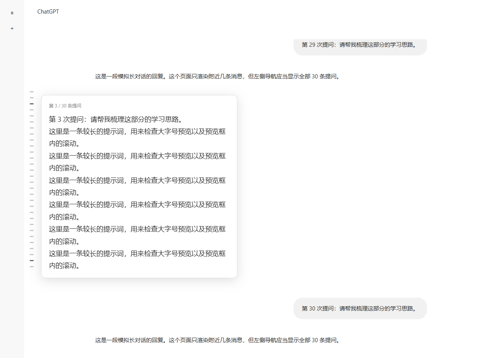

# ChatGPT Prompt Navigation

A small Chrome extension that adds a vertical rail of short lines to the left edge of a ChatGPT conversation. Each line represents one user prompt. Hover to preview it; click to jump to it.

[简体中文](README.md) · [Download](https://github.com/YidanPan/chatgpt-prompt-nav/releases/latest)



## Features

- Reads the current conversation's saved history, including older pages and the active branch.
- Aligns the actual prompt bubble below the header, accounting for quoted selections and delayed layout changes.
- Large 18px hover previews, up to 520px wide, with scrollable long text.
- Attempts to locate virtualized messages that are not mounted in the page yet.
- Supports keyboard navigation and light/dark themes, while preserving ChatGPT's own sidebar.
- Click the extension's toolbar icon to customize normal and highlighted line colors. Changes are saved locally, applied across open chat tabs, and can be reset to the theme defaults.

## Install

1. Download and extract the extension ZIP from [Releases](https://github.com/YidanPan/chatgpt-prompt-nav/releases/latest).
2. Open `chrome://extensions` and enable **Developer mode**.
3. Choose **Load unpacked** and select the extracted folder containing `manifest.json`.
4. Open or reload ChatGPT and wait for the history to load.

If using the repository source, load **`extension/`**, not the repository root. No build or Node.js installation is needed to use the extension. Keep the loaded folder in place.

To update, replace the extension files, reload the extension on the extensions page, and then reload your ChatGPT tabs.

## Privacy and limitations

Requests use your existing session and go only to the current ChatGPT origin. There is no external backend, telemetry, or persistent chat storage. The only extension permission is `storage`, used to store the two color preferences locally, without cloud sync. Tokens are used in memory and are not written to logs or files. No API key is required. The extension does not send, edit, or delete messages.

ChatGPT's private web endpoints and DOM can change. Incomplete history reads are explicitly reported. Temporary chats can only use prompts already rendered in the page. Virtualized-message navigation may take a few seconds or fail on unsupported layouts. Manual interaction cancels alignment. Physical scroll boundaries may prevent exact top alignment near the end of a short conversation.

Version 1.2.1 was checked on a signed-in ChatGPT page for quoted-prompt alignment. Automated tests use synthetic fixtures and do not cover every account or rollout.

## Development

Node.js 22+:

```sh
npm ci
npm run check
npm test
npx playwright install chromium
npm run test:browser
npm run package
```

On Linux, use `npx playwright install --with-deps chromium` if dependencies are missing. `PLAYWRIGHT_CHROMIUM_EXECUTABLE_PATH` can select an existing test browser. Tests run in isolated profiles against intercepted synthetic pages, without accessing your usual browser profile.

Packaging requires Python 3 and produces `dist/chatgpt-prompt-nav-v1.3.0.zip`. See [CONTRIBUTING.md](CONTRIBUTING.md) and [ACKNOWLEDGMENTS.md](ACKNOWLEDGMENTS.md).

## License

[MIT](LICENSE). Independent third-party project; not affiliated with OpenAI, ChatGPT, or Codex.
