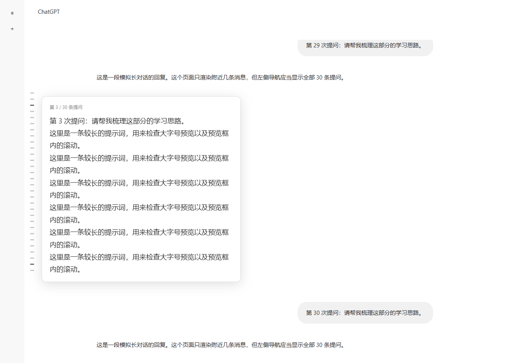

# ChatGPT 提示词导航

在 ChatGPT 聊天内容区左侧显示一列短横线。**每条横线对应你的一次提问，悬停预览，点击跳转。**

简体中文 · [English](README.en.md) · [下载最新安装包](https://github.com/YidanPan/chatgpt-prompt-nav/releases/latest)



## 功能

- **完整提问列表**：自动读取当前聊天的历史分页，不必先手动往上划；只列出当前分支的用户提问。
- **准确跳转**：对齐提示词气泡开头，排除引用卡片和附件的影响；根据顶部栏位置调整，并复核懒加载和排版产生的偏移。
- **大字预览**：18px 字号、520px 宽度；鼠标可移入预览框，滚动阅读完整长提示词。
- **适应长对话**：未渲染的消息会尝试自动定位；横线间距按数量调整，特别长的列表可单独滚动。
- **键盘和主题**：聚焦横线后，可按上下方向键、Home / End 选择，Enter 跳转；跟随页面深浅色。

保留 ChatGPT 原生侧栏。没有聊天管理、搜索、分组、置顶、设置页面或统计服务。

## 安装到 Chrome

1. 在 [Releases](https://github.com/YidanPan/chatgpt-prompt-nav/releases/latest) 下载 `chatgpt-prompt-nav-v1.2.1.zip` 并解压。
2. Chrome 地址栏输入 `chrome://extensions`，开启右上角的「开发者模式」。
3. 点击「加载已解压的扩展程序」，选择解压后**包含 `manifest.json` 的文件夹**。
4. 打开或刷新 [ChatGPT](https://chatgpt.com/)，等待历史载入。

也可以下载仓库源码，并在第 3 步选择其中的 **`extension/`** 文件夹。不需要安装 Node.js 或运行构建命令。请保留加载时选择的文件夹。

**更新**：将新版本文件替换到原文件夹，在扩展管理页点击插件的刷新按钮，随后再次刷新 ChatGPT 标签页。当前版本为 **1.2.1**。

## 隐私与工作原理

插件通过 ChatGPT 本站的只读历史接口建立当前聊天的提问索引，支持分页历史和旧版对话树。使用已有登录会话，无需 API Key。

- 仅匹配 `https://chatgpt.com/*` 和旧域名 `https://chat.openai.com/*`；不申请额外扩展权限。
- 请求仅发送到当前 ChatGPT 域名，不使用第三方后端、遥测或广告。
- 登录凭据只在浏览器内存中用于历史读取，不保存到文件、日志或扩展存储。
- 提问索引保留在当前标签页内存中；切换聊天或刷新后重新建立。
- 不修改、发送、删除聊天，也不会把对话内容包含在本项目的测试或发布包里。

## 兼容性与限制

ChatGPT 的网页历史接口和页面结构均可能改变。登录过期、接口限制或结构不兼容时，会提示历史尚未完整读取，并保留已识别的部分，不会把部分结果标成全部。

临时聊天没有已保存的完整历史，只能导航页面中已渲染的提问。极旧消息的页面加载可能需要几秒，也可能定位失败；手动滚轮、触摸或点击页面可中断校准。接近页面底部且剩余内容不足时，滚动边界也会限制顶部对齐。

版本 1.2.1 已在登录后的真实 ChatGPT 页面检查过带引用提问的落点。自动测试使用合成数据，覆盖完整历史分页、虚拟消息渲染、延迟排版和用户中断；这不代表覆盖全部账号布局和网站灰度版本。

## 本地开发与验证

需要 Node.js 22+。插件本身是原生 JavaScript + Manifest V3，无运行时依赖。

```sh
npm ci
npm run check
npm test
npx playwright install chromium
npm run test:browser
npm run package
```

Linux 上首次安装浏览器可使用 `npx playwright install --with-deps chromium`。如需使用已有的测试用 Chromium，可设置 `PLAYWRIGHT_CHROMIUM_EXECUTABLE_PATH`。测试使用独立资料目录和拦截生成的网页，不访问你的 Chrome 资料或真实聊天。

打包需要 Python 3。`npm run package` 生成包含插件、说明和许可证的 `dist/chatgpt-prompt-nav-v1.2.1.zip`。不要把仓库根目录当作插件文件夹加载。

```text
extension/       插件源码与图标
tests/          历史读取模型和浏览器集成测试
scripts/        语法检查与打包
docs/           模拟对话预览图
```

## 贡献与许可

欢迎通过 Issues 报告问题或提交 PR。请说明 Chrome 版本、插件版本、普通聊天或项目聊天、复现步骤；截图请遮盖私人内容，不要提供 Cookie、访问令牌或完整聊天记录。更多开发说明见 [CONTRIBUTING.md](CONTRIBUTING.md)。

采用 [MIT License](LICENSE)。网页接口兼容性参考见 [ACKNOWLEDGMENTS.md](ACKNOWLEDGMENTS.md)。

独立第三方扩展，与 OpenAI、ChatGPT 或 Codex 官方无隶属关系。
